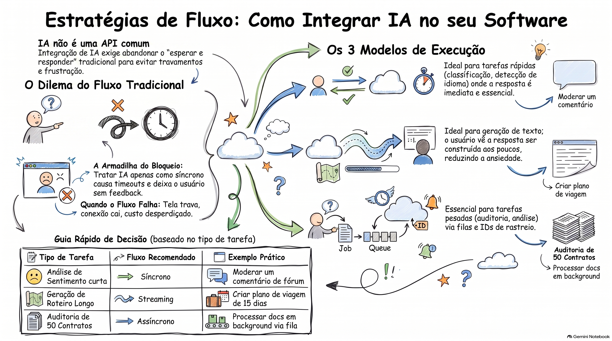

# Fluxos de Execução e Integração de Inteligência Artificial

Este documento analisa as estratégias de integração de modelos de Inteligência Artificial (IA) em fluxos de software, contrastando o modelo tradicional de requisição e resposta com as necessidades específicas de processamento de linguagem natural e análise de dados complexos.

## Sumário

A integração bem-sucedida de IA em aplicações exige uma mudança de paradigma em relação ao modelo tradicional de Request/Response. Enquanto operações web comuns (como cadastros e buscas) são previsíveis e rápidas, as chamadas de IA possuem comportamentos variáveis: podem ser rápidas, demoradas, fragmentadas ou exigir processamento intensivo de grandes volumes de dados.

A escolha do fluxo de execução — Síncrono, Streaming ou Assíncrono — é determinada pela natureza da tarefa e pela experiência do usuário (UX) desejada. O erro comum de tratar todas as chamadas de IA como bloqueantes resulta em timeouts, instabilidade do sistema e percepção negativa do usuário. A arquitetura deve, portanto, adaptar-se para fornecer feedbacks constantes, gerenciar estados de processamento em segundo plano e otimizar a percepção de tempo de resposta.

---

## 1. O Desafio da Integração no Fluxo Real

O desenvolvimento tradicional de aplicações web baseia-se no fluxo síncrono: o usuário realiza uma ação, o servidor processa e devolve a resposta completa. No entanto, chamadas de IA introduzem variáveis que rompem essa lógica:

- **Variabilidade de Tempo:** Dependendo da complexidade do prompt ou do volume de dados (ex: analisar códigos extensos ou revisar logs), a resposta pode demorar de segundos a minutos.
- **Processamento em Partes:** Muitas vezes, a IA gera a resposta de forma incremental.
- **Riscos de Bloqueio:** Segurar uma conexão HTTP por muito tempo pode causar estouro de timeout, levando o usuário a repetir a ação e sobrecarregar o sistema com tarefas duplicadas.

---

## 2. Padrões de Fluxo de Execução

Abaixo, detalham-se as três abordagens principais para integrar chamadas de IA ao software:

### 2.1 Chamada Síncrona

É o modelo mais simples, onde o back-end aguarda a resposta final da IA antes de retornar ao cliente.

- **Quando utilizar:** Em tarefas objetivas, com entradas e saídas pequenas, onde o usuário precisa do resultado imediato para prosseguir.
- **Exemplos Práticos:**
  - Classificação de sentimento em comentários curtos (ex: moderar um fórum).
  - Detecção de idioma ou formatação de datas.
  - Filtragem de palavrões.
- **Limitações:** Torna-se um problema se a tarefa exigir análise profunda (ex: traduzir um e-book de 300 páginas). Se a IA falha ou demora, toda a requisição falha, gerando insegurança no usuário.

### 2.2 Streaming de Dados

Neste formato, a aplicação entrega pedaços da resposta conforme eles são gerados pela IA.

- **Percepção de Valor:** O tempo total de processamento pode ser o mesmo do síncrono, mas o "tempo para o primeiro retorno" diminui drasticamente. O usuário vê a resposta sendo construída (ex: "Analisando marcadores... a alteração parece relacionada à glicemia").
- **Quando utilizar:** Respostas narrativas, descritivas ou relatórios textuais (ex: roteiros de viagem, análise de exames médicos, redação de e-mails).
- **Quando evitar:** Quando a resposta precisa de uma estrutura final rígida e validada antes de ser útil, como um arquivo XML completo ou decisões estruturadas que dependem de todos os campos para fazer sentido.
- **Exigência Técnica:** Requer que o back-end envie dados em partes e o front-end os exiba progressivamente.

### 2.3 Processamento Assíncrono (Jobs)

A tarefa é retirada do caminho principal da requisição HTTP e enviada para um processamento em segundo plano (background).

- **Funcionamento:** A aplicação recebe o pedido, cria um registro de tarefa com um identificador único (Job ID), devolve esse ID ao usuário e inicia o processamento fora da thread principal.
- **Quando utilizar:** Tarefas pesadas e de longa duração.
  - Auditoria de dezenas de contratos de trabalho.
  - Tradução de livros inteiros ou decodificação de horas de vídeo.
  - Renderização de modelos 3D complexos.
- **Infraestrutura:** Geralmente utiliza filas e mensageria como AWS SQS, Celery ou Google Pub/Sub.
- **Gestão de Estado:** O job deve transitar por estados: `Pending` (Pendente), `Processing` (Processando), `Completed` (Concluído) ou `Failed` (Falha).

---

## 3. Implementação Técnica e Regras Práticas

A análise técnica baseada em exemplos de código (Python/Pydantic) reforça a necessidade de modelos de dados bem definidos (schemas) para garantir a integridade da comunicação.

### Tabela Comparativa de Tomada de Decisão

| Fluxo          | Critério de Escolha                              | Percepção do Usuário                             | Exemplo de Uso                                           |
| :------------- | :----------------------------------------------- | :----------------------------------------------- | :------------------------------------------------------- |
| **Síncrono**   | Resposta curta e essencial para o próximo passo. | Imediata, mas bloqueante.                        | Classificar avaliação de restaurante (Higiene: Alta).    |
| **Streaming**  | Resposta longa onde o conteúdo parcial é útil.   | Dinâmica e ágil.                                 | Geração de análise clínica de um PDF de exames.          |
| **Assíncrono** | Tarefa pesada com risco de timeout HTTP.         | Desconectada (recebe aviso de conclusão depois). | Auditoria completa de contratos de trabalho para riscos. |

### Ciclo de Vida de um Job Assíncrono

Para garantir a resiliência do sistema, o fluxo assíncrono deve seguir etapas de gerenciamento de estado:

1. **Criação:** O usuário faz um POST, o sistema gera o ID e marca como `pending`.
2. **Execução:** Um worker captura a tarefa, marca como `processing` e chama o cliente de IA (ex: GPT-4o Mini).
3. **Finalização:** Após a resposta da IA, o status é atualizado para `completed` (com o resultado salvo) ou `failed` (em caso de erro), permitindo consultas (polling) ou notificações via SMS/Webhooks.

---

## Conclusão

A integração de IA não é apenas uma questão de conectividade com APIs, mas de design de fluxo. A arquitetura deve priorizar a disponibilidade do servidor e a transparência para o usuário. Se uma tarefa demora o suficiente para gerar insegurança ou risco de interrupção da conexão, ela deve ser migrada para um modelo de streaming ou processamento assíncrono.

### [Assista ao resumo em vídeo](https://github.com/user-attachments/assets/9c04102d-853c-477c-b341-eefd5287048d)
