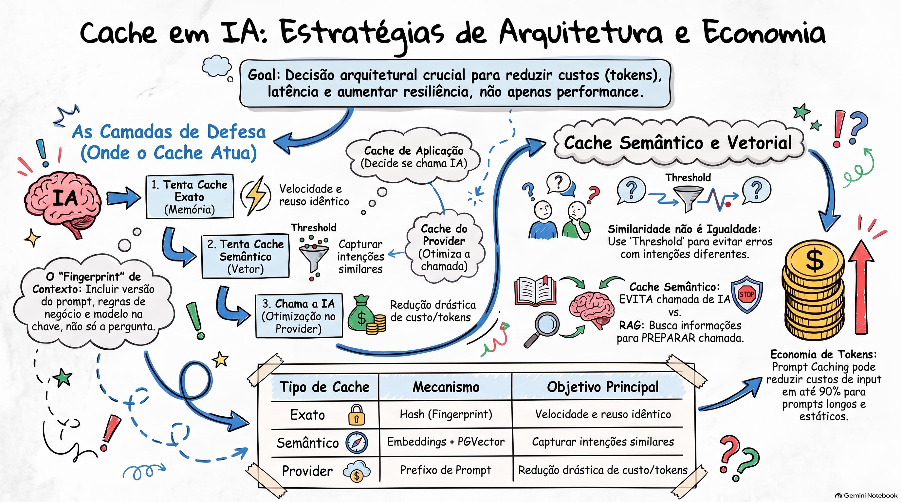

# Estratégias e Arquitetura de Cache para Inteligência Artificial

## Sumário

A implementação de cache em aplicações baseadas em Inteligência Artificial (IA) transcende a técnica clássica de otimização de performance. Em sistemas que utilizam Modelos de Linguagem de Grande Escala (LLMs), o cache torna-se uma **decisão de arquitetura crítica** fundamentada em três pilares:

- Redução de custo financeiro
- Resiliência operacional
- Mitigação de latência

O documento detalha a transição do **"cache ingênuo"** para o **"cache contextual"**, onde a validade de uma resposta não depende apenas da entrada do usuário, mas da **Identidade de Contexto** — versão do prompt, regras de negócio e capacidade do modelo.

São exploradas as camadas de:

- Cache exato
- Cache semântico
- Cache de provedor

O uso estratégico dessas ferramentas pode reduzir significativamente os custos de inferência e melhorar a experiência do usuário ao evitar chamadas desnecessárias aos provedores de IA.

---

## 1. O Novo Papel do Cache na Era da IA

Em aplicações tradicionais, o cache visa evitar consultas ao banco de dados ou chamadas de API para acelerar a resposta.

Na IA, cada chamada ao modelo envolve variáveis complexas que tornam o cache ainda mais relevante:

- **Latência de Inferência:** o tempo de processamento dos modelos é significativamente superior ao de consultas tradicionais.
- **Custo Financeiro:** cada token consumido pode gerar cobrança.
- **Limites de Uso (Rate Limits):** provedores impõem restrições de requisições por minuto.
- **Instabilidade e Variação:** modelos podem apresentar respostas inconsistentes ou sofrer falhas externas.

A pergunta central muda de:

> "Como deixar a aplicação mais rápida?"

Para:

> **"Esta chamada para a IA realmente precisa acontecer de novo?"**

### O Cache como Fonte de Erro

Diferente de dados estáticos, a resposta da IA depende de um conjunto mutável de fatores.

Reutilizar um cache antigo pode ser tecnicamente válido, mas arquiteturalmente errado se:

- O **Prompt** foi ajustado para melhorar a precisão.
- As **Regras de Negócio** ou políticas de conformidade mudaram.
- O **Modelo** ou seus parâmetros, como temperatura, foram alterados.

---

## 2. Padrões de Implementação e Ciclo de Vida

A arquitetura baseada no padrão **Cache-Aside** é uma das mais recomendadas.

O fluxo é:

1. A aplicação consulta o cache.
2. Se houver um **Hit**, retorna a resposta armazenada.
3. Se houver um **Miss**, chama a IA.
4. A aplicação valida o resultado.
5. A resposta é armazenada no cache para uso futuro.

### Conceitos Fundamentais

| Conceito               | Descrição na Aplicação de IA                                                                                                |
| ---------------------- | --------------------------------------------------------------------------------------------------------------------------- |
| **TTL (Time to Live)** | Tempo de vida da resposta. Deve ser curto em contextos voláteis, como fraude, e pode ser longo em classificações estáticas. |
| **Resposta Stale**     | Uma resposta antiga que ainda está no cache, mas pode não representar a melhor decisão atual devido a mudanças nas regras.  |
| **Invalidação**        | Mecanismo para remover um item do cache. Pode ocorrer manualmente, por tempo ou por mudança de versão do sistema.           |
| **Hit e Miss**         | O _Hit_ evita tokens, latência de inferência e dependência do provedor. O _Miss_ exige processamento completo.              |

---

## 3. Identidade de Contexto e Fingerprint

O **"cache ingênuo"** olha apenas para o texto de entrada.

O cache avançado utiliza o conceito de **Fingerprint** (assinatura única) para garantir que a resposta seja válida apenas no contexto em que foi gerada.

A **Cache Key** deve ser um Hash resultante da combinação de:

1. **Versão do Prompt:** qualquer alteração no texto do sistema invalida o cache anterior.
2. **Versão das Regras:** políticas de negócio e diretrizes da aplicação.
3. **Capacidade do Modelo:** o tipo ou versão do modelo utilizado, como GPT-4o vs GPT-3.5.
4. **Texto Normalizado:** a entrada do usuário após limpeza de espaços e conversão para minúsculas.

Essa estrutura evita que a aplicação misture respostas produzidas sob condições diferentes, garantindo maior integridade para decisões de negócio.

### Exemplo conceitual

```text
Cache Key =
HASH(
    prompt_version +
    rules_version +
    model_version +
    normalized_user_input
)
```

### [Assista ao resumo em vídeo](https://github.com/user-attachments/assets/1b2cb54a-fc69-40fc-a4f6-96c75f92cfcb)
