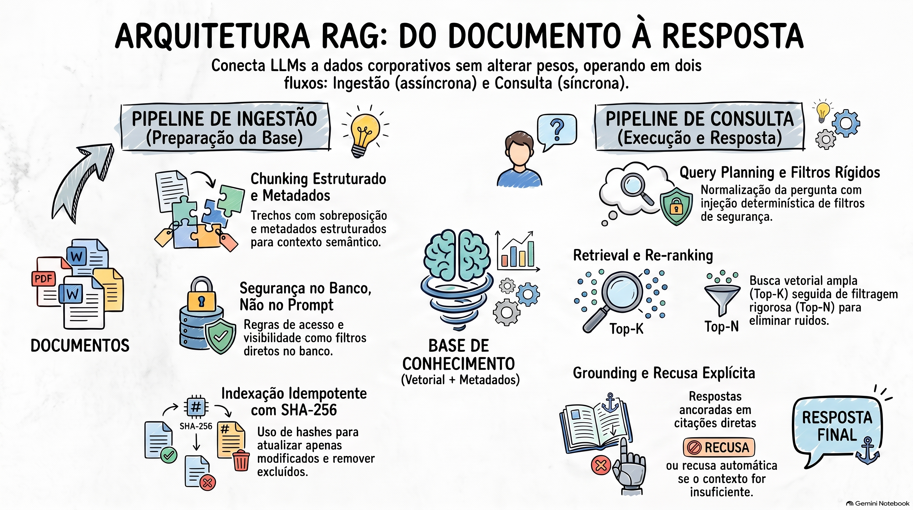

# Arquitetura, Implementação e Melhores Práticas de Retrieval-Augmented Generation (RAG)

## Sumário

O Retrieval-Augmented Generation (RAG) consolidou-se como um padrão arquitetural essencial para conectar Modelos de Linguagem de Grande Porte (LLMs) a bases de conhecimento externas e proprietárias. Em sua essência, o RAG resolve a limitação fundamental de respostas genéricas e desatualizadas de modelos pré-treinados, permitindo que a aplicação recupere trechos textuais relevantes em tempo real e os injete no contexto do modelo antes da geração da resposta.

Diferente de abordagens baseadas exclusivamente em fine-tuning (onde o modelo altera seus pesos de forma permanente) ou Long Context (onde documentos inteiros são inseridos diretamente no prompt), o RAG opera como um pipeline de software multiestágio. A qualidade da resposta final de um sistema RAG não depende isoladamente da capacidade do LLM, mas de uma cadeia de dependências crítica: qualidade da ingestão → precisão dos metadados → eficiência da busca (retrieval) → seleção de contexto (re-ranking) → geração fundamentada (grounding).

### Principais Conclusões Teóricas e Práticas:

1. **RAG é para Recuperação de Conhecimento:** Não substitui bancos de dados transacionais (SQL/APIs) para dados ao vivo ou mutáveis, nem substitui sistemas de workflow e tool calling para execução de ações.
2. **O Banco Vetorial Não é a Fonte da Verdade:** O vector store é um índice derivado. A fonte primária da verdade é o documento original. Se a base de dados original muda, o índice deve ser atualizado por meio de pipelines de reindexação idempotentes baseados em manifestos e assinaturas digitais (hashes SHA-256).
3. **Segurança e Permissões Pertencem à Aplicação:** Filtros de visibilidade, tenant, nível de acesso e regras de negócio devem ser aplicados rigorosamente pela arquitetura da aplicação durante a busca (where clauses em metadados) e jamais delegados às instruções do prompt do LLM.
4. **Otimização Multi-Etapas (Query Planning e Re-ranking):** Perguntas brutas de usuários contêm ambiguidades e ruídos. A introdução de camadas de planejamento de consulta (Query Planner) e reordenação de candidatos (Re-ranking) reduz drasticamente os tokens de entrada, elimina custos com contextos irrelevantes e minimiza alucinações.
5. **A Importância da Recusa Explícita:** Sistemas maduros em produção devem ser programados para se recusar abertamente a responder quando o contexto recuperado for insuficiente, garantindo rastreabilidade e auditabilidade através da citação direta das fontes utilizadas.

---

## 1. Fundamentos e Conceitos Arquiteturais do RAG

### O Problema do Conhecimento Paramétrico

Aplicações corporativas alimentadas por IA frequentemente enfrentam o problema das respostas genéricas. Um LLM comercial possui um conhecimento genérico do mundo obtido no seu pré-treinamento, mas desconhece totalmente as regras de negócio específicas, manuais internos, apólices de seguro, tabelas de preço ou procedimentos operacionais de uma empresa. Esse conhecimento reside em sistemas externos — arquivos PDF, intranets, planilhas Excel, guias no SharePoint ou bases no Confluence.

### O que é RAG?

RAG é a sigla para Retrieval-Augmented Generation (Geração Aumentada por Recuperação). Trata-se de um padrão de arquitetura de software projetado para conectar o modelo de linguagem ao conhecimento externo sem modificar os pesos do modelo (fine-tuning).

Analogicamente, o RAG funciona como um pesquisador que entrega um dossiê com anotações precisas a um jornalista antes que este escreva uma matéria, garantindo que o texto final seja baseado exclusivamente em dados garimpados nos arquivos corporativos.

```text
[ Usuário ] ---> ( Pergunta )
                    |
                    v
[ Aplicação ] ---> [ Busca de Contexto no Índice ]
                    |
                    v
[ Aplicação ] ---> [ Montagem do Prompt Aumentado (Instruções + Contexto) ]
                    |
                    v
[ Modelo LLM ] ---> ( Geração da Resposta com Fontes )
```

### RAG como um Pipeline Integrado

O RAG não é uma simples chamada de API a um LLM ou um mero banco vetorial. É um pipeline dividido em dois fluxos operacionais independentes:

- **Pipeline de Ingestão (Tempo de Carga / Assíncrono):** Leitura de documentos, extração de texto (parsing), enriquecimento com metadados, divisão em trechos menores (chunking), geração de vetores (embeddings) e indexação no banco de dados.
- **Pipeline de Consulta (Tempo de Pergunta / Síncrono):** Recebimento da pergunta do usuário, interpretação/planejamento da consulta, busca semântica e filtragem por metadados, seleção e reordenação de contexto (re-ranking), montagem do prompt final e geração da resposta pelo LLM.

---

## 2. RAG em Comparação com Outras Estratégias

A seleção da solução técnica correta depende de onde a informação necessária reside e do tipo de operação esperada.

| Estratégia                               | Cenário Ideal                                                                                                         | Vantagens                                                                                                                    | Limitações                                                                                                          |
| :--------------------------------------- | :-------------------------------------------------------------------------------------------------------------------- | :--------------------------------------------------------------------------------------------------------------------------- | :------------------------------------------------------------------------------------------------------------------ |
| **RAG (Retrieval-Augmented Generation)** | Conhecimento não estruturado espalhado em documentos, políticas, manuais, FAQs e contratos.                           | Escalável para bases gigantescas; respostas rastreáveis e atualizáveis em tempo real; controle refinado de custos de tokens. | Requer infraestrutura de busca e ingestão; não garante verdade se o documento estiver incorreto.                    |
| **Long Context (Prompt Direto)**         | Bases documentais muito pequenas (ex: cardápio de 1 página, guia rápido curto).                                       | Arquitetura simples; sem necessidade de bancos vetoriais ou pipelines complexos.                                             | Alto consumo de tokens; latência elevada em bases grandes; estouro da janela de contexto; dificuldade de auditoria. |
| **SQL / Chamadas de API**                | Dados estruturados, estado atual do sistema, informações transacionais ao vivo (ex: saldo de estoque, última compra). | Precisão determinística; dados em tempo real.                                                                                | Incapaz de processar textos não estruturados ou responder a dúvidas conceituais complexas.                          |
| **Tool Calling / Workflows**             | Execução de ações no sistema (ex: "suspenda a assinatura da conta X").                                                | Permite automação de processos e regras de negócio ativas.                                                                   | Requer integrações complexas e validação rigorosa de segurança.                                                     |
| **Fine-Tuning**                          | Adaptação do estilo, tom de voz, formato de saída ou vocabulário especializado do modelo.                             | Ajusta o comportamento e o formato da resposta do LLM.                                                                       | Não resolve atualização dinâmica de conhecimento; custoso; suscetível a alucinações de fatos específicos.           |

---

## 3. O Pipeline de Ingestão e Preparação da Base de Conhecimento

A qualidade final da resposta depende criticamente do pipeline de ingestão. Erros cometidos na fase de ingestão corrompem as etapas subsequentes do RAG (_Garbage In, Garbage Out_).

```text
[ Documento Bruto ] ---> [ Parsing & Front-Matter ]
                            |
                            v
[ Extração de Metadados ] + [ Chunking Estruturado + Overlap ]
                            |
                            v
[ Enriquecimento com Headers ] ---> [ Geração de Embeddings ]
                                          |
                                          v
                               [ Armazenamento no Vector Store ]
```

### A Importância dos Metadados Estruturados

Metadados funcionam como abas coloridas em um fichário físico, permitindo que a aplicação execute cláusulas `WHERE` no banco de dados e restrinja a busca semântica antes do escaneamento vetorial completo.

#### Metadados Fundamentais:

- **Identificadores Corporativos:** `tenant`, `id_cliente`, `id_filial`, `departamento`.
- **Classificação de Conteúdo:** `categoria_doc` / `doctype` (ex: diretriz, contrato, FAQ, faturamento, módulo), `modulo_sistema`, `assunto`.
- **Governança e Segurança:** `nivel_permissao` / `visibility` (público, interno, restrito, gerente), `estado_publicacao` / `status` (ativo, rascunho, em revisão, revogado).
- **Versionamento e Auditoria:** `versao` / `revisao`, `data_atualizacao`, `source_file` (origem: e-mail, SharePoint, S3, API, planilha).

### Estratégias de Chunking (Divisão de Documentos)

O chunking é uma decisão arquitetural central. Um chunk é a unidade de texto que disputará espaço na busca semântica.

- **Chunks Excessivamente Grandes:** Tornam a busca genérica, diluem o significado semântico e consomem espaço desnecessário no contexto.
- **Chunks Excessivamente Pequenos:** Perdem o sentido isolado, resultando em trechos descontextualizados incapazes de sustentar uma resposta coesa.

#### Boas Práticas de Chunking:

1. **Divisão Estruturada por Headers (Markdown Splitter):** Respeitar a hierarquia do documento (títulos H1, H2, H3), garantindo que seções lógicas permaneçam unificadas.
2. **Recursive Character Text Splitter:** Configuração típica de 900 caracteres por chunk com 150 caracteres de sobreposição (overlap). O overlap preserva o contexto nas fronteiras entre trechos vizinhos.
3. **Injeção de Contexto no Conteúdo do Chunk (Header Injection):** Concatenar metadados e o caminho dos títulos (headers) diretamente no texto bruto do chunk antes de gerar o embedding. Isso garante que termos curtos ou tabelas isoladas carreguem a intenção do documento completo (ex: transformar um trecho que diz "Prazo: 30 dias" em "Documento: Recursos Humanos > Seção: Férias CLT > Prazo: 30 dias").

### Consistência, Hashes e Indexação Idempotente

O banco vetorial não é a fonte primária da verdade. Para evitar que o sistema responda com informações antigas ou duplicadas quando um documento muda, o pipeline de ingestão deve ser idempotente.

#### Algoritmo do Manifest e Fingerprinting:

1. **Cálculo do Hash SHA-256:** Para cada arquivo da base, gera-se uma assinatura digital baseada em seu conteúdo.
2. **Consulta ao Manifesto (`index_manifest.json`):** A ingestão compara o estado atual dos arquivos com o registro anterior.
3. **Classificação de Fontes (`classify_sources`):**
   - **Novos (New):** Arquivos inexistentes no manifesto são convertidos em chunks e indexados.
   - **Modificados (Changed):** Se o hash SHA-256 mudou, o sistema remove cirurgicamente do banco vetorial todos os chunks atrelados àquele arquivo e indexa a nova versão.
   - **Inalterados (Unchanged):** Ignorados, evitando reindexação e gastos desnecessários com embeddings.
   - **Removidos (Removed):** Arquivos excluídos da pasta física têm seus chunks apagados do banco vetorial.

---

## 4. O Pipeline de Consulta e Estratégias Avançadas de Retrieval

A fase de consulta transforma a pergunta simples do usuário em uma busca precisa e fundamentada.

```text
[ Pergunta do Usuário ]
          |
          v
[ Query Planner ] ---> ( Normalização, Termos Exatos, Detecção de Ambiguidade )
          |
          +---> [ Se Ambíguo ] ---> ( Solicita Esclarecimento ao Usuário )
          |
          v
[ Safe Filters ] ---> ( Tenant, Produto, Status=Ativo, Regras de Permissão )
          |
          v
[ Retrieval ] -------> ( Busca por Similaridade Vetorial -> Retorna Top-K Candidatos )
          |
          v
[ Re-ranking ] ------> ( Filtra Ruídos, Reordena e Seleciona Top-N Chunks )
          |
          v
[ Prompt Final ] ----> ( Instruções de Recusa + Contexto Delimitado + Pergunta )
          |
          v
[ Resposta Final ] --> ( Geração Estruturada com Citação Direta de Fontes )
```

### Query Planning (Planejamento da Consulta)

A pergunta bruta do usuário raramente está otimizada para busca vetorial (contém vícios de linguagem, ambiguidades ou faltam termos técnicos). O Query Planner insere uma camada leve de inteligência antes da busca:

- **Normalização:** Reescreve a pergunta de forma autocontida e objetiva.
- **Extração de Parâmetros:** Identifica automaticamente os tipos de documento (`doctypes`), planos, módulos e termos literais exatos.
- **Detecção de Ambiguidade:** Se a pergunta for excessivamente abrangente (ex: "Como funciona o cancelamento?" sem especificar se é plano Mensal, Anual ou Corporativo), o sistema marca `needs_clarification: true` e solicita esclarecimentos ao usuário imediatamente, sem consumir chamadas ao banco ou ao LLM final.

> **Regra de Ouro de Segurança:** O Query Planner pode interpretar a intenção da pergunta, mas jamais deve decidir os níveis de autorização do usuário. Filtros de segurança (tenant, empresa, nível de acesso) devem ser injetados de forma determinística pela aplicação (Safe Filters).

### Estratégias de Retrieval e Busca Vetorial

A busca vetorial encontra trechos semanticamente próximos via similaridade de cosseno ou distância euclidiana. Parâmetros críticos:

- **Top-K (Quantidade de Candidatos):** Quantidade inicial de chunks recuperados (ex: buscar 8 a 30 candidatos).
- **Filtros Combinados (Hybrid Filtering):** Execução de filtros estruturados simultâneos no banco vetorial (ex: `WHERE tenant = 'Acme' AND status = 'publicado' AND doctype IN ('faturamento', 'diretriz')`).

### Re-ranking: Seleção e Filtragem de Ruído

Mandar todos os candidatos recuperados pelo retrieval direto para o LLM aumenta o custo de tokens, eleva a latência e insere ruído no prompt, o que pode induzir o modelo ao erro. O Re-ranking separa a etapa de buscar candidatos da etapa de escolher os vencedores:

1. A busca vetorial resgata um número maior de candidatos (Top-K = 8 ou 15).
2. O mecanismo de Re-ranking avalia cada trecho contra a pergunta e seleciona apenas os melhores (Top-N = 3 ou 4).
3. Se nenhum trecho for considerado realmente relevante, o Re-ranker retorna uma lista vazia, disparando a recusa imediata do sistema sem expor o modelo final a contextos irrelevantes.

#### Alternativas de Re-ranking:

- **LLM Re-ranking (Structured Output):** Utilização de um modelo de linguagem para avaliar a relevância dos chunks candidatos (didático e preciso, porém adiciona latência e custo por requisição).
- **MMR (Maximal Marginal Relevance):** Algoritmo matemático que equilibra relevância com diversidade, evitando que 4 chunks idênticos ocupem o contexto.
- **Busca Híbrida + RRF (Reciprocal Rank Fusion):** Combinação da busca semântica vetorial com busca lexical por texto completo (Postgres FTS / BM25) para valorizar códigos, siglas e números exatos.
- **Cross-Encoders e Boosts por Metadados:** Modelos especializados em pontuação de relevância ou aplicação de pesos adicionais em metadados específicos.

### Formatação do Contexto, Grounding e Recusa

O prompt final entregue ao modelo de geração deve estabelecer um contrato rigoroso:

```text
SYSTEM PROMPT:
Você é um assistente de suporte especializado. Responda à pergunta do usuário utilizando APENAS o contexto fornecido abaixo. Não utilize conhecimentos prévios e não invente informações.

Se o contexto não contiver informações suficientes para responder com segurança, defina 'has_answer' para false e retorne exatamente a mensagem padrão de recusa.

CONTEXTO RECUPERADO:
---
Documento: [politica_faturamento.md] | Seção: [Prazos] | Versão: [2026.1] | Chunk ID: [hash_01]
Conteúdo: Os reembolsos aprovados são processados em até 7 dias úteis.
---

PERGUNTA DO USUÁRIO:
[Qual o prazo para receber meu reembolso?]
```

#### Saída Estruturada (Pydantic Schema):

A resposta da aplicação deve ser validada por esquemas rígidos (`structured_output`):

- `answer` (string): A resposta direta gerada para o usuário.
- `has_answer` (boolean): `true` se o contexto suporta a resposta, `false` se a base é insuficiente.
- `sources` (list): Lista contendo exclusivamente os `chunk_ids` utilizados para embasar a resposta (rastreabilidade e auditabilidade total).

---

## 5. Arquitetura Técnica, Observabilidade e API HTTP

O projeto de referência foi construído utilizando uma pilha moderna, desacoplada e pronta para produção.

### Stack Tecnológica do Projeto:

- **Linguagem & Framework Base:** Python 3.11+, Pydantic v2 (validação de dados e configurações de ambiente via `.env`).
- **Orquestração de IA:** LangChain (conectores, splitters e modelos de embedding e chat).
- **Banco de Dados Vetorial:** PostgreSQL com extensão PGVector (executado via Docker Compose, utilizando instâncias PGVector e tabelas com suporte a vetores e JSONB para metadados).
- **Provedor de Modelos LLM:** OpenAI (gpt-3.5-turbo para chat/query planning/reranking e modelos de embedding vetorial).
- **Exposição de Serviços:** FastAPI (API HTTP assíncrona) e CLI para testes operacionais via terminal.

### Arquitetura de Classes do Pipeline

Toda a lógica de orquestração do RAG foi encapsulada na classe `RAGPipeline`, permitindo ser consumida tanto por scripts CLI quanto por rotas FastAPI sem duplicação de regras:

```text
[ Cliente HTTP / Front-End ] ---> [ Endpoint REST (FastAPI) ]
                                          |
                                          v
[ CLI Terminal (reg_chat.py) ] ---> [ RAGPipeline.run() ]
                                          |
                                          +---> 1. QueryPlanner.plan()
                                          +---> 2. VectorStore.similarity_search()
                                          +---> 3. Reranker.rerank()
                                          +---> 4. LLM.generate_answer()
```

### Instrumentação e Observabilidade

Aplicações de IA generativa exigem métricas de telemetria específicas que vão além de métricas tradicionais de TI.

```json
{
  "request_id": "req_89f7a2b1",
  "has_answer": true,
  "needs_clarification": false,
  "use_rerank": true,
  "retrieved_counts": 8,
  "selected_chunks_count": 3,
  "selected_sources": ["manual_sla.md", "diretrizes_suporte.md"],
  "latency_ms": {
    "query_planning_ms": 118.5,
    "retrieval_ms": 42.1,
    "rerank_ms": 1850.3,
    "generation_ms": 2100.2,
    "total_ms": 4111.1
  },
  "usage": {
    "model": "gpt-3.5-turbo",
    "input_tokens": 1240,
    "output_tokens": 85,
    "total_tokens": 1325
  }
}
```

#### Gargalos Revelados pela Telemetria:

A observabilidade permite identificar instantaneamente compromissos (_trade-offs_) de arquitetura. Nos testes práticos da aplicação:

- **Requisição completa COM Re-ranking por LLM:** Latência média de ~4.8 a 5.1 segundos.
- **Requisição completa SEM Re-ranking (`use_rerank=false`):** Latência reduzida para ~2.1 segundos.

> **Decisão Arquitetural:** Em cenários onde tempo de resposta é crítico, substitui-se o Re-ranking por LLM por estratégias determinísticas (MMR, busca híbrida ou filtros rígidos de metadados).

---

## 6. Análise Comparativa "Build vs. Buy" (Construção Própria vs. Soluções Gerenciadas)

A decisão entre construir um pipeline RAG próprio ou adotar plataformas gerenciadas de provedores de nuvem envolve custos, prazo e necessidade de controle.

| Provedor / Solução  | Componente Gerenciado                                               | Pontos Fortes                                                                                                                                                      | Limitações / Trade-offs                                                                                                                                      |
| :------------------ | :------------------------------------------------------------------ | :----------------------------------------------------------------------------------------------------------------------------------------------------------------- | :----------------------------------------------------------------------------------------------------------------------------------------------------------- |
| **Google Cloud**    | Vertex AI RAG Engine (Gemini Enterprise Agent Platform)             | Ingestão automática; conectores nativos para Google Drive, Cloud Storage e repositórios locais; integração direta com o ecossistema Gemini.                        | Opacidade no controle granular de chunking; risco de vendor lock-in.                                                                                         |
| **AWS**             | Amazon Bedrock Knowledge Bases                                      | Totalmente hospedado (opções Customer Managed ou Fully Managed); conectores prontos para S3, Salesforce, Zendesk, Notion, Confluence e Web Crawlers.               | Custo por requisição/armazenamento pode escalar rápido; personalização restrita de algoritmos de busca.                                                      |
| **Microsoft Azure** | Azure AI Search (e Foundry IQ)                                      | Suporte a RAG Clássico (busca híbrida + semantic ranking) e Agentic Retrieval com query planning dinâmico; controle estrito de permissões corporativas (Entra ID). | Complexidade de configuração inicial; custos de infraestrutura dedicada de busca.                                                                            |
| **OpenAI**          | File Search API (Responses / Assistants)                            | Extremamente simples de implementar; gerencia automaticamente a criação de vector stores, chunking e busca híbrida integrada ao LLM.                               | "Caixa-preta" total; impossível customizar regras de re-ranking ou ajustar pipelines de ingestão próprios; custos atrelados a tokens e armazenamento OpenAI. |
| **Solução Própria** | Pipeline Customizado do Zero (Python, LangChain, Postgres/PGVector) | Controle absoluto sobre chunking, metadados, regras de autorização, query planning, re-ranking e observabilidade; sem lock-in; custo previsível de infraestrutura. | Requer equipe técnica madura para manter conectores, pipelines de ingestão, reindexação contínua e bancos vetoriais.                                         |

**A Regra do 80/20:** Soluções gerenciadas resolvem 80% dos casos de uso comuns de forma rápida. No entanto, se a busca contextual e o conhecimento corporativo representam o coração do produto, exigindo permissões complexas, auditorias rígidas e regras customizadas, a construção de uma arquitetura própria ou híbrida é altamente recomendada.

---

## 7. Checklist Arquitetural para RAG em Produção

Antes de implantar uma solução RAG em ambiente de produção, a equipe de engenharia e arquitetura deve validar os dez critérios a seguir:

- [ ] **1. Natureza do Problema:** Foi confirmado que a dúvida do usuário depende de conhecimento não estruturado contido em documentos (manuais, políticas, FAQs) e NÃO de dados transacionais ao vivo (saldo, estado de compras, chamados abertos)?
- [ ] **2. Definição da Fonte da Verdade:** O documento original é mantido como a única fonte da verdade, ficando claro que o banco vetorial e o LLM são apenas mecanismos de busca e geração derivados?
- [ ] **3. Inviabilidade do Long Context Direto:** Foi verificado que a base documental é grande ou dinâmica o suficiente para justificar o RAG, descartando o uso de simples inclusão de textos curtos no prompt (Long Context) ou estratégias de cache?
- [ ] **4. Governança e Segurança no Nível da Aplicação:** As permissões de acesso, tenant, visibilidade e regras de sigilo estão sendo aplicadas via código (Safe Filters / cláusulas WHERE na busca de metadados) e NÃO confiadas a instruções de texto no prompt do LLM?
- [ ] **5. Pipeline de Ingestão Idempotente:** O sistema possui mecanismos de versionamento, cálculo de hashes (SHA-256) e uso de manifestos para atualizar e remover automaticamente chunks desatualizados ou excluídos?
- [ ] **6. Inspecionabilidade do Retrieval:** A aplicação oferece ambiente de debug e telemetria capaz de isolar e visualizar a pergunta normalizada, os filtros aplicados, os chunks retornados na busca e os scores de similaridade antes de chamar o LLM?
- [ ] **7. Mecanismo de Recusa e Grounding:** O sistema foi instruído e testado para recusar explicitamente a resposta (`has_answer: false`) quando a base não contiver evidências suficientes, citando exatamente as fontes (`chunk_ids`) quando houver resposta?
- [ ] **8. Gestão de Custos e Latência:** As chamadas de IA do pipeline (Query Planner, Retrieval, Re-ranking e Geração) são instrumentadas com medição rigorosa de tempos por etapa e consumo de input/output tokens?
- [ ] **9. Avaliação Consciente de Build vs. Buy:** Foi ponderada a decisão entre construir um pipeline customizado ou contratar um provedor gerenciado (Vertex, Bedrock, Azure AI Search, OpenAI) com base na maturidade do time, prazo e necessidade de controle?
- [ ] **10. Rastreabilidade de Ponta a Ponta:** Toda resposta gerada pelo sistema pode ser rastreada com clareza até o parágrafo exato do documento original que a fundamentou?

### [Assista ao resumo em vídeo](https://github.com/user-attachments/assets/d96e8603-ef92-481a-8e0d-3ac47bc7dd56)
